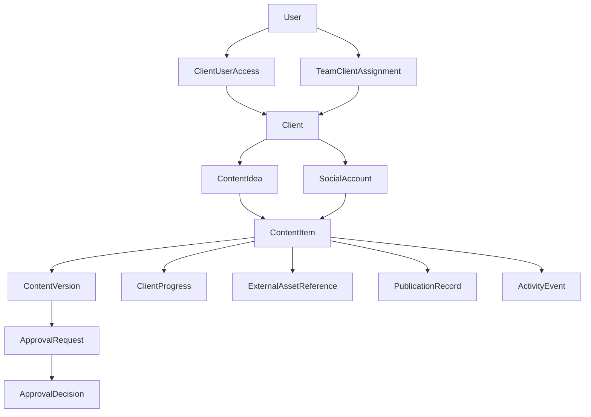

# Social Media Operations System
## Complete Product Requirements & Phase-by-Phase Development Plan

> **Current workflow update — 2 November 2026:** The user replaced the multi-page
> workflow with Client → Social account → Posts sheet. No business-first or idea
> setup step is required. All formats have content approval and final approval;
> Reels additionally track WhatsApp footage and editing. Titles/dates are edited
> in cells; copy, reviews and references stay in a side panel. Agency quality
> confirmation is part of sending final review. Manual publication is now recorded
> in the row. README.md and the current-workflow section in SETUP.md supersede
> historical interface and phase assumptions below.

> **Current implementation decisions:** This system serves one agency. The user
> selected only **Agency** and **Client** roles: every Agency user has full
> workspace access, while Clients access only their mapped organizations. These
> decisions supersede the Admin/Team Member split and staff assignment restrictions
> in the original blueprint below. The selected stack is Next.js/React/JavaScript/
> Tailwind, a separate Express backend, MySQL with Prisma, and Firebase Authentication.
> See SETUP.md for the current implementation decisions.

> **Document status:** Development blueprint — Version 3.0  
> **Prepared:** 31 October 2026  
> **Product:** Multi-client social media agency operations platform  
> **Primary goal:** Improve planning, approvals, accountability, production tracking, and posting consistency — **without replacing WhatsApp or automating social publishing**.

---

## Quick summary: what are we building?

Think of the agency as a school. The agency prepares the work, clients approve scripts and record videos, and team members edit and publish the content. WhatsApp is where everyone talks and sends files. This application is the shared checklist and calendar that answers:

- What content have we promised each client and platform?
- What is being worked on right now?
- Who has to do the next thing — agency or client?
- What is late or likely to be late?
- Has the client approved the **correct version**?
- What has actually been published?

**In one sentence:** WhatsApp is for communication and file exchange; our application is for planning, approvals, progress updates, ownership, and monitoring.

### Decisions already finalized

| Topic | Final decision |
|---|---|
| Roles | **Exactly three login roles:** Admin, Team Member, Client |
| Client access | **Yes.** Client logs in to review, approve, request revisions, update shoot/footage status, and view their content. |
| WhatsApp | Keep existing group and direct chats for communication and file sharing. |
| WhatsApp integration | **Not required.** No WhatsApp API, bot, parser, scraping, or auto-import in MVP. |
| Raw-media hosting | **Not required in MVP.** Files remain where they are shared today (primarily WhatsApp). |
| Script and structured data | Stored in the application database. |
| Finished-creative review | Review/approval is recorded in the application against a **specific identified version**; media can be viewed in WhatsApp or through an optional external preview URL. |
| Publishing | Manual posting to Instagram, LinkedIn, etc.; mark the result in the application. |
| Multi-platform clients | A single client can manage multiple accounts/platforms, with separate deliverables and calendars. |
| Team setup | No separate Writer, Editor, Designer, QA, Publisher, or Manager *roles*. Any Team Member can receive multiple kinds of assignments. |
| Product priority | Lean, fast, mobile-friendly, low-data-entry workflow rather than a generic project-management suite. |

### How to use this document

1. **Phase 0** defines the workflow and locks business rules.
2. **Phases 1–6** build the functional MVP in dependency order.
3. **Phase 7** validates and launches it with real clients.
4. **Phase 8** contains optional improvements after the MVP proves useful.
5. **Appendices A–F** are the reference specification for developers, testers, and designers.

No phase should be considered complete simply because its screens look finished. Each phase includes exit/acceptance criteria and a concrete deliverable.

---

# Table of Contents

- [1. Product goals, boundaries, and success measures](#1-product-goals-boundaries-and-success-measures)
- [2. Roles and access rules](#2-roles-and-access-rules)
- [3. The improved agency operating workflow](#3-the-improved-agency-operating-workflow)
- [4. Full two-way workflows by content type](#4-full-two-way-workflows-by-content-type)
- [5. Phase-by-phase development roadmap](#5-phase-by-phase-development-roadmap)
  - [Phase 0 — Workflow discovery and product specification](#phase-0--workflow-discovery-and-product-specification)
  - [Phase 1 — App foundation, users, clients, and platforms](#phase-1--app-foundation-users-clients-and-platforms)
  - [Phase 2 — Content planning and multi-platform calendar](#phase-2--content-planning-and-multi-platform-calendar)
  - [Phase 3 — Production tracking and WhatsApp handoffs](#phase-3--production-tracking-and-whatsapp-handoffs)
  - [Phase 4 — Client portal and two-way approvals](#phase-4--client-portal-and-two-way-approvals)
  - [Phase 5 — Work queues, alerts, and monitoring](#phase-5--work-queues-alerts-and-monitoring)
  - [Phase 6 — Publishing log, reports, and operating controls](#phase-6--publishing-log-reports-and-operating-controls)
  - [Phase 7 — Quality assurance, pilot, and launch](#phase-7--quality-assurance-pilot-and-launch)
  - [Phase 8 — Optional improvements after launch](#phase-8--optional-improvements-after-launch)
- [6. Screens and navigation inventory](#6-screens-and-navigation-inventory)
- [7. Data model and relationships](#7-data-model-and-relationships)
- [8. Workflow state machine and business rules](#8-workflow-state-machine-and-business-rules)
- [9. API design and implementation notes](#9-api-design-and-implementation-notes)
- [10. Security, reliability, and non-functional requirements](#10-security-reliability-and-non-functional-requirements)
- [11. Testing scenarios and definition of done](#11-testing-scenarios-and-definition-of-done)
- [12. Recommended development backlog](#12-recommended-development-backlog)
- [13. Pilot rollout and change management](#13-pilot-rollout-and-change-management)
- [14. Risks, limitations, and decisions to confirm](#14-risks-limitations-and-decisions-to-confirm)
- [Appendix A — Sample content record](#appendix-a--sample-content-record)
- [Appendix B — Sample weekly operating routine](#appendix-b--sample-weekly-operating-routine)
- [Appendix C — Example notifications and messages](#appendix-c--example-notifications-and-messages)
- [Appendix D — Suggested dashboard definitions](#appendix-d--suggested-dashboard-definitions)
- [Appendix E — Suggested repository structure](#appendix-e--suggested-repository-structure)
- [Appendix F — Final MVP acceptance checklist](#appendix-f--final-mvp-acceptance-checklist)

---

# 1. Product goals, boundaries, and success measures

## 1.1 Problems we are solving

**Current situation:** The agency handles several clients, often across Instagram and LinkedIn. Strategy, scripts, production, approvals, and publishing overlap. Communication and raw footage live in WhatsApp groups and individual chats. A person must remember which client approved which script, when a shoot is expected, which post is due next, and why something is late.

**Typical failure cases:**

- A client approves a script, but nobody tracks the promised shooting date.
- A client says they sent footage in a private WhatsApp chat; the editor still cannot find all clips.
- The team edits an older version after the client requested a change.
- A carousel is ready, but nobody knows whether the *final* creative was approved.
- An Instagram post is published, but the LinkedIn adaptation was forgotten.
- A team member's absence or workload delays posts with no early warning.
- Management discovers a missed weekly target only at the end of the month.

## 1.2 Product outcomes

The product must let the agency:

1. Set client/platform publishing commitments.
2. Plan reusable content ideas and platform-specific deliverables.
3. Assign one **internal owner** and a clear **next responsible party** for every deliverable.
4. Let clients participate directly through approvals and progress updates.
5. Track manual WhatsApp file handoffs without requiring duplicate uploads.
6. Detect deadline risks before publishing dates are missed.
7. Record what was manually published and produce meaningful consistency reports.
8. Add more clients without adding proportionally more coordination work.

## 1.3 What we are *not* building in the MVP

- A WhatsApp replacement or in-app chat product.
- WhatsApp Business API integration, automatic media ingestion, or message synchronization.
- Cloud hosting or playback of every raw video and final creative.
- Instagram/LinkedIn publishing API integrations or auto-posting.
- Social performance analytics pulled automatically from social platforms.
- AI content generation, auto-writing, or AI approval.
- Billing, payroll, attendance, CRM sales pipeline, or invoicing.
- Custom workflow designer, multi-layer organizational hierarchy, or dozens of permission roles.
- A complete DAM (digital asset management) system or enterprise file archive.

These are deliberate exclusions, not missing features.

## 1.4 Initial success indicators

Define baseline measurements during the pilot. Then monitor:

| Metric | Why it matters |
|---|---|
| On-time publishing rate | Are committed posts going out as planned? |
| Next-7-day readiness | Do clients have enough approved posts prepared? |
| Client action turnaround | How long are scripts, shoots, and approvals waiting? |
| Internal production turnaround | How long do prepared inputs take to become ready posts? |
| Content blocked by client vs agency | Where is the real bottleneck? |
| Revision rate | Are briefs and approvals clear enough? |
| Manual tracking time | Is the new system reducing coordination overhead? |

Do **not** set arbitrary performance percentages as official KPIs before the team has a baseline.

---

# 2. Roles and access rules

There are **three and only three application roles in the MVP**.

| Role | Can do | Cannot do |
|---|---|---|
| **Admin** | Manage users, clients, accounts, plans, assignments, approvals, system settings, dashboards, publishing records, and access | Cannot falsify a client-authored approval event; manual off-platform decisions must be clearly attributed |
| **Team Member** | View assigned clients/content, create or edit permitted content, update progress, submit for client approval, verify WhatsApp footage, record publishing | Cannot access unrelated clients, change global settings, or grant new permissions |
| **Client** | View their own content and platforms, approve/request changes, add feedback/ideas, update shooting status, report footage sent, view the content calendar and history | Cannot view other clients, private internal notes, agency-wide workloads, or alter internal assignments/publishing evidence |

### Role is not the same as responsibility

A person can write scripts, design carousels, edit reels, and publish posts **without having four roles**. Use per-content `assignedToUserId`, optional `workType`, and `internalOwnerId`. A Team Member can serve several clients. An Admin can execute any team task.

### Client access can include multiple people

One client organization may have one or more Client users, such as its founder and marketing coordinator. Each Client user belongs to permitted client organizations. In the MVP, this is a **mapping**, not a fourth role or nested department structure.

### Ownership rule

Every non-cancelled content item must have:

- **Internal owner:** Someone within the agency accountable for follow-up and accuracy.
- **Next responsible party:** `AGENCY` or `CLIENT`.
- **Next action:** A short human-readable instruction.
- **Next action due date:** When the next dependency should be completed.

**Example:** Internal owner = Asha, responsible party = Client, next action = “Send raw footage in WhatsApp,” due = 4 November.

---

# 3. The improved agency operating workflow

## 3.1 Use three planning horizons

- **Next 30 days — strategy:** Themes, key dates, campaign goals, posting targets, major content ideas and platform mix.
- **Next 14 days — production:** Scripts in preparation, shoot plans, design tasks, rough production deadlines, review windows and dependency owners.
- **Next 7 days — ready buffer:** Aim to have evergreen content already approved for the coming week. Urgent or trend-based content may follow a shorter route.

These are operating targets, not hard product constraints. They should be configurable to suit each client.

## 3.2 Stop treating every post as a separate WhatsApp project

The system stores a **content idea** and one or more **content items** created from it.

Example:

```text
Client: ABC Fitness
└── Idea: Why you feel sleepy after lunch
    ├── Instagram Reel (script, shoot, edit, final approval)
    └── LinkedIn Post (copy, review, publish)
```

Both content items share an idea but have **independent** captions, owners, due dates, approvals, publishing dates, and publishing outcomes.

## 3.3 Weekly operating rhythm

| When | Agency habit | System support |
|---|---|---|
| Start of week | Check every client's content readiness and blockers | Exception dashboard and upcoming dates |
| Planning window | Batch ideas, briefs and scripts for upcoming posts | Bulk creation and calendar planning |
| Client review window | Clients approve scripts/copy and provide shoot availability | Client action queue, due dates, revision comments |
| Production window | Team edits/designs items with complete inputs | Work queue filtered by actionable items |
| Final review | Check facts, formatting, creative and caption; obtain approval | Internal QA and final version approvals |
| Publishing | Manually publish approved content | “Ready to publish” queue and publishing record |
| End of week | Compare planned vs published, identify root causes | Client/platform consistency report |

## 3.4 Rules that reduce errors

1. Plan before the publishing date; never use the planned date as the only production deadline.
2. Group script and review requests where possible, but keep approvals tied to individual versions.
3. Every blocked item must say **what it is waiting for** and **who needs to act**.
4. Client-selected shooting dates are recorded; their uncertainty is reflected in the publishing plan.
5. A client marking “footage sent” is a **claim**, not verification. The agency confirms receipt/usability.
6. A missed review deadline creates a warning. **Silence never means approval.**
7. Material changes after approval require a new version and a new relevant approval.
8. A post may be “Ready” only after its required approvals and internal checks are complete.
9. Every published item records its platform, actual publish time, publisher, and link or documented exception.
10. Changes to assignments, deadlines, approvals, and publication history are auditable.

---

# 4. Full two-way workflows by content type

## 4.1 Reel: agency → client → agency → client → agency

```text
AGENCY                                  CLIENT
  |                                        |
  | Create idea, script and date           |
  |------ Request script approval -------->|
  |                                        | Approve or request edits
  |<----- Decision and comments -----------|
  |                                        |
  | (If changes: revise and resend)        |
  |                                        | Shoot approved script
  |                                        | Send clips in WhatsApp
  |<----- Mark footage sent in system -----|
  | Verify WhatsApp files                  |
  | Edit video; complete internal QA       |
  |------ Request final approval --------->|
  |                                        | Approve or request revision
  |<----- Decision and comments -----------|
  |                                        |
  | Manually publish to Instagram          |
  | Record post URL and date               |
```

### The crucial WhatsApp handoff

1. Client sends the raw video in an existing WhatsApp group or DM.
2. Client opens their portal and marks **“Footage sent”** for that reel. Optional: enter the channel, send time and clip count.
3. The app changes `footageStatus` to `REPORTED_SENT`, and notifies the internal owner **inside the application**.
4. The team member checks WhatsApp. They choose **“Received & usable”** or **“Missing / unusable clips”** and record a short note.
5. Only `VERIFIED_RECEIVED` can unlock the editor's production task.
6. The actual video remains in WhatsApp. The app saves **metadata and verification**, not the video bytes.

This avoids duplicate uploading while maintaining accountability. It also means the app cannot technically prove file contents or guarantee permanent media retention; see [Section 14](#14-risks-limitations-and-decisions-to-confirm).

## 4.2 Carousel: agency → client → agency

```text
Idea / brief → draft copy → client copy review (if required)
→ design slides → agency QA → client final approval
→ ready → manually publish → record URL
```

No shooting or raw-footage stage. A client may request changes to slide copy, artwork, or caption. A change to final reviewed material must create a new version before renewed approval.

## 4.3 LinkedIn text-only post

```text
Idea → write copy → internal check → client approval of final copy
→ ready → manually publish → record URL
```

Do not add an unnecessary editing or second approval stage when there is no visual asset. Use format-based stage requirements.

## 4.4 Client-initiated content idea

```text
Client submits idea/request in portal
→ Agency triages (accept / needs details / decline / backlog)
→ If accepted, agency creates planned item(s)
→ Normal content workflow
```

For the MVP, a client suggestion is **not** automatically a committed post. The agency must accept it and place it into the calendar.

## 4.5 Revisions and rejected approvals

- **Request Changes** requires a meaningful comment so the agency knows what to fix.
- Revision request is attached to the exact script/creative version.
- Resubmission creates `version + 1` and a new pending approval request.
- Previous approvals remain in history and are marked as superseded when appropriate.
- Client sees the latest submitted version, revision notes and relevant history, not unrelated internal comments.
- The final approval must represent the final content **as identified in the system**.

## 4.6 When there are multiple social accounts

One client may have `@brand` Instagram, `@founder` Instagram, and a LinkedIn company page. The system tracks **social accounts**, not merely platform names. A content item belongs to one target account; repurposing creates linked sibling items, one per destination.

---

# 5. Phase-by-phase development roadmap

## Phase 0 — Workflow discovery and product specification

**Purpose:** Agree on real operating rules before creating screens or tables.

### Business activities

- [ ] Audit examples of recent reels, carousels, LinkedIn posts, delays and revisions.
- [ ] Map what the team currently sends in WhatsApp groups vs DMs.
- [ ] Confirm how clients receive scripts and final-creative previews.
- [ ] Define required approvals per content format; avoid a universal oversized workflow.
- [ ] Define posting commitments: per account, per week, by format where needed.
- [ ] Agree on the meaning of “script approved,” “footage sent,” “received,” “ready,” and “published.”
- [ ] Assign an internal owner for every client, even though **Manager is not a role**.
- [ ] Decide how final creatives will be identified for approval when the file itself stays on WhatsApp.
- [ ] Decide initial client action SLAs and weekly production routines.

### Design and product deliverables

- [ ] Confirmed user journeys for Admin, Team Member and Client.
- [ ] Approved role/permission matrix.
- [ ] Workflow diagrams for Reel, Carousel and Text Post.
- [ ] Content field glossary and status-transition table.
- [ ] Wireframes of essential screens (desktop and mobile).
- [ ] Prioritized backlog with MVP vs later labels.

### Phase 0 exit criteria

- Everyone can describe **who acts next** after each client and agency action.
- No unresolved confusion about WhatsApp vs application responsibilities.
- Final creative review and version identification are unambiguous.
- The team approves the scope before coding starts.

---

## Phase 1 — App foundation, users, clients, and platforms

**Purpose:** Build secure access and the hierarchy for managing more than one client/account.

### Build

- [ ] Set up application repository, environments, linting, formatting, logging, and database migrations.
- [ ] Build authentication: invitation, login, logout, password reset, secure sessions.
- [ ] Implement server-side role permissions for **ADMIN, TEAM_MEMBER, CLIENT**.
- [ ] Admin can create, archive, and edit client profiles.
- [ ] Admin can create Team Member and Client users.
- [ ] Assign Team Members to permitted clients.
- [ ] Map one or more Client users to one or more permitted client organizations.
- [ ] Add multiple social accounts per client: platform, handle/page name, active status, publishing timezone.
- [ ] Add planned weekly posting commitment for each account, optionally by content type.
- [ ] Add basic user profile and account settings.
- [ ] Build navigation shell and responsive layouts for each role.

### Required screens

- Login and password reset
- Admin client list and create/edit client
- Client profile → social accounts
- Team users and client assignments
- Client portal shell (empty state is fine in this phase)

### Acceptance criteria

- [ ] Admin can create ABC Fitness with an Instagram account and a LinkedIn account.
- [ ] Admin can assign a Team Member to ABC Fitness and another member to a different client.
- [ ] Assigned Team Member sees ABC Fitness but not unrelated clients.
- [ ] ABC Fitness Client user can log in and cannot see any other client's data.
- [ ] A client with two platforms sees both accounts under one client profile.
- [ ] Unauthorized direct API requests fail, even when someone guesses an ID.

**Deliverable:** Secure multi-client foundation with three roles and platform configuration.

---

## Phase 2 — Content planning and multi-platform calendar

**Purpose:** Know what needs to be posted, on which social account, and by when.

### Build

- [x] Create content ideas/topics with a short brief, notes, and optional content bucket/campaign.
- [x] Create platform-specific content items under an idea.
- [x] Support Reel, Carousel, Static Graphic, Story, LinkedIn Text, Document Post and generic Other format.
- [x] Support draft script/copy and initial caption text stored in the application.
- [x] Set proposed publish date, priority, internal owner, assigned contributor, and production due date.
- [x] Build month/week/list calendar views, filtered by client, platform, content type, owner and status.
- [x] Configure weekly targets for each social account and show planned counts.
- [x] Duplicate/repurpose an idea into another social account while keeping its own workflow and approvals.
- [x] Add bulk content creation and bulk rescheduling where safe.
- [x] Show conflicts/missing information (e.g., no owner, past date, no target account).
- [x] Add calendar notes for shoots, campaigns, public holidays and important events, without external calendar integration.

### User experience

The Admin can open ABC Fitness, see Instagram and LinkedIn in one combined calendar, and filter them separately. A Team Member can see only permitted accounts and assigned content. A Client sees their upcoming planned content, marked clearly as **tentative**, **in progress**, or **approved**.

### Acceptance criteria

- [x] Plan 4 Instagram items and 3 LinkedIn items for one week without duplicate client profiles.
- [x] Create a main idea and generate two platform-specific items from it.
- [x] Changing the LinkedIn caption does not alter the Instagram caption.
- [x] Changing the publishing date preserves previous date history.
- [x] Planned count and weekly target are visible per account.
- [x] Client cannot silently edit agency-owned planned publish dates.

**Deliverable:** A working multi-platform content calendar and planning tool.

---

## Phase 3 — Production tracking and WhatsApp handoffs

**Purpose:** Turn a content plan into an accountable execution pipeline **without storing WhatsApp files**.

**Implementation status (2 November 2026):** Built and verified through the live API
using the Agency/Client roles selected above. Approval gates currently use clearly
attributed Agency records of external decisions; interactive Client approval is
Phase 4. Responsive styles are implemented; mobile browser acceptance is pending.

### Build

- [x] Create the format-aware workflow engine described in [Section 8](#8-workflow-state-machine-and-business-rules).
- [x] Add a content detail page with next action, party responsible, internal owner, dates, history, notes and approvals section.
- [x] Add stage transitions for agency work: drafting, production, internal QA, submitted for review, ready.
- [x] Add fields for shoot scheduled, shoot completed, footage reported sent, footage verified received, and unusable/missing footage.
- [x] Add structured **WhatsApp reference metadata**: group/DM, reported sender, file description, reported date/time, number of clips, optional message reference, internal verification note.
- [x] Build “Verified received” vs “Needs reshoot / missing files” actions.
- [x] Add revision/version numbering for scripts and final creative references.
- [x] Add internal-only notes and a short event/activity timeline.
- [x] Make next actions visible in the assigned Agency user's queue.
- [x] Use one **content item** as the central record; do not generate a separate free-floating task for each tiny stage.
- [x] Prevent impossible state transitions; show useful error messages.

### WhatsApp reference rules

A WhatsApp attachment is **not automatically saved** into the application. Reference fields are optional context to help people locate files. They are not proof of the file's permanent existence. Do not require WhatsApp deep links because they may be absent or not usable across devices/accounts.

### Acceptance criteria

- [x] Reel is waiting for footage: client reported sent does **not** mark it ready for editing.
- [x] Agency confirms usable clips and the editing work becomes actionable.
- [x] Missing clips route the item back to a client action without losing the history.
- [x] Carousel skips the shoot/footage stage.
- [x] LinkedIn text post does not require reel editing.
- [x] All status changes record actor and timestamp.
- [ ] Team Member can complete a typical progress update quickly from mobile.

**Deliverable:** Reliable production tracker, client-dependency states, and manual WhatsApp handoff verification.

---

## Phase 4 — Client portal and two-way approvals

**Purpose:** Allow clients to make decisions and update their own progress **inside the application**.

**Implementation status (2 November 2026):** Implemented with Agency/Client roles.
Live API checks cover attributed decisions, current versions, stale/concurrent
requests, privacy, release gates and Client suggestions. Existing dashboard data
is preserved. Browser/mobile visual acceptance remains pending.

### Build — Client dashboard

- [x] “Needs Your Action” section: script/copy approval, shoot update, footage confirmation, final creative approval.
- [x] “Upcoming Content” calendar covering all permitted social accounts.
- [x] “My Suggestions” for submitting new content ideas or requested changes.
- [x] Clear mobile-first navigation; avoid internal agency jargon.
- [x] Show action due dates and what happens after each decision.

### Build — Script/copy approval

- [x] Show latest script/copy directly in the application, including version number.
- [x] Client chooses **Approve** or **Request Changes**.
- [x] Changes require written feedback.
- [x] Decision is signed with the authenticated client user, exact content version, and timestamp.
- [x] New revision invalidates the affected approval; Agency resubmission creates a pending request, preserving prior decisions.

### Build — Shooting and footage updates

- [x] Client can set `Not started`, `Shoot scheduled`, or `Recorded` with optional planned date.
- [x] Client can mark **“Footage sent on WhatsApp”**, select group/DM (optional), and add short context.
- [x] Application shows the verification action in the internal owner's work queue; notifications remain Phase 5.
- [x] Client sees whether agency verified footage or requested more clips.

### Build — Final creative approval

- [x] Agency submits a specific final-creative reference (`v1`, `v2`, etc.), caption/copy and short summary for review.
- [x] Show a precise identifier: title, version, content account, date and optional **external** preview link.
- [x] If creative stays only in WhatsApp, present an explicit acknowledgment: “I reviewed Version v2 shared in WhatsApp on [date/reference].”
- [x] Client approves or requests changes for **that exact version**.
- [x] Approval of `v1` cannot automatically apply to `v2`.
- [x] An approval only creates a “Ready” item when all other required checks are completed.

### Build — Off-platform fallback

Sometimes a client gives feedback or approval verbally or in WhatsApp instead of the portal. Authorized agency staff may log it as a **manually recorded client decision**, with the source/channel and note, clearly labeled `RECORDED_BY_AGENCY` and never impersonating an authenticated client action. Whether this can satisfy final-release requirements is a configurable agency policy; default to requesting actual portal approval for final creatives.

### Acceptance criteria

- [x] Client logs in and approves an exact script version; the result is saved and visible to Agency on refresh.
- [x] Client requests revisions with a comment; the team has an actionable task.
- [x] Client marks footage sent; team must still verify receipt.
- [x] Client approves the final version from their own login.
- [x] A modified version invalidates an earlier final approval.
- [x] A client cannot access another client's script by changing the URL.
- [x] Internal-only notes never appear in the client portal.

**Deliverable:** Functional two-way agency/client collaboration with authenticated client decisions.

---

## Phase 5 — Work queues, alerts, and monitoring

**Purpose:** Make risks visible without manually checking dozens of client trackers.

### Build

- [ ] Admin dashboard showing agency-wide upcoming posts, overdue actions, approvals, blocked work and readiness.
- [ ] Team Member “My Work” queue grouped by ready to work, waiting on client, due soon and overdue.
- [ ] Client “My Actions” queue sorted by urgency; all action buttons work on mobile.
- [ ] In-app notifications for submitted approvals, requested changes, client shoot updates, footage-verification needs and task reassignment.
- [ ] Configurable due-date warnings with a daily scheduled health evaluation (no WhatsApp messaging).
- [ ] Status summaries per client and account, including the next 7 days.
- [ ] Explicit **blocker cause**: waiting for script approval, footage, design, team edit, final approval, publication, etc.
- [ ] A simple activity feed showing recent important changes.
- [ ] Safe notification deduplication: do not send a new in-app alert every minute for the same overdue item.

### Suggested health rules (initially configurable)

- **At risk:** A required dependency is overdue, or expected completion is later than the planned publication time.
- **No ready buffer:** Upcoming posting commitments exist but available approved content for the next 7 days is below the agency's chosen target.
- **Blocked by client:** Next responsible party is Client and action is overdue.
- **Blocked internally:** Next responsible party is Agency and action is overdue.
- **Missed post:** Planned publishing slot has passed and the item has not been marked published or deliberately rescheduled/cancelled.

Do not label the entire client “healthy” using a hidden arbitrary formula. Show the underlying reason and counts.

### Acceptance criteria

- [ ] Delayed raw footage creates a visible client blocker.
- [ ] Script approved by client removes the approval blocker.
- [ ] An overdue item stays pending; it is never auto-approved.
- [ ] Admin sees combined client health and can drill into the exact items causing problems.
- [ ] Team Member sees only permitted work.
- [ ] Notifications are not spammy or duplicated.

**Deliverable:** An operations dashboard that makes daily follow-ups targeted and proactive.

---

## Phase 6 — Publishing log, reports, and operating controls

**Purpose:** Close the loop from planning to actual delivery and learn from bottlenecks.

### Build

- [ ] “Ready to Publish” queue filtered by account, date and content type.
- [ ] Publishing checklist: correct platform/account, approved version, final caption, hashtags/links, formats, internal QA, posting slot.
- [ ] Manual **Mark Published** action with actual publish timestamp, publisher, account, URL (when available), and notes.
- [ ] Record planned date vs actual publish date; reschedules remain in activity history.
- [ ] Block publication status for items lacking required approvals unless an authorized, recorded exception policy applies.
- [ ] Reports for weekly/monthly planned vs published counts by client/platform.
- [ ] Report delay reasons: client footage, client approvals, agency drafting, editing, final QA, publication, other.
- [ ] Export summaries as CSV (lightweight), not a full BI engine.
- [ ] Reusable content and client templates where they genuinely reduce repeated data entry.

### Report definitions

- **Planned:** Count of distinct content items committed to a time window for a particular social account, excluding cancelled items according to agreed rules.
- **Published:** Count of distinct content items marked published with a recorded timestamp.
- **On-time:** Published no later than the agreed publishing deadline; avoid comparing day-only plans to minute-level timestamps unless time was committed.
- **Client delay:** Time an item remained awaiting a client action beyond its due date.
- **Production delay:** Time an agency-owned action remained overdue.

### Acceptance criteria

- [ ] An approved Instagram reel can be marked published with its live post URL.
- [ ] The LinkedIn adaptation remains independent and unpublished until separately completed.
- [ ] A missed post appears as missed, not silently removed from the plan.
- [ ] Changing a publishing date creates a traceable reschedule event.
- [ ] A weekly report shows counts and reasons, not just a green/red status.
- [ ] Reports respect client and user permissions.

**Deliverable:** Manual publishing log, transparent consistency reports, and closing checks.

---

## Phase 7 — Quality assurance, pilot, and launch

**Purpose:** Make the system reliable in real agency conditions before everyone depends on it.

### Technical QA

- [ ] Unit tests for state transitions, approval invalidation, permissions, and dashboard calculations.
- [ ] Integration tests for create → approval → WhatsApp handoff → production → final approval → publish.
- [ ] Cross-client isolation and negative authorization tests.
- [ ] Concurrent edit protection (version/conflict handling) to avoid overwriting someone else's updates.
- [ ] Form validation, action idempotency, and audit log verification.
- [ ] Mobile usability on low bandwidth and common screen widths.
- [ ] Backup/restore test for database and configuration.
- [ ] Secure deployment, environment separation and monitoring.
- [ ] Accessibility review: buttons, keyboard use, error states, contrast and labels.

### Real-world pilot

Use a small set of representative clients:

1. Instagram-only client with regular reels and carousels.
2. Client with Instagram and LinkedIn content.
3. Client with frequent shoot delays, revision requests, or mixed WhatsApp group/DM usage.

### Pilot procedure

- [ ] Import upcoming plans and active content items.
- [ ] Train Admin/Team Members on brief status updates and client handoffs.
- [ ] Train clients on only three actions: approve, request changes, update shoot/footage.
- [ ] Run the process with real deliverables and review friction daily.
- [ ] Record missing or redundant clicks and confusing statuses.
- [ ] Fix critical bugs and simplify repeated actions.
- [ ] Compare planned vs published output and coordination effort against baseline.
- [ ] Declare go-live only when final acceptance checklist passes.

**Deliverable:** Production-ready MVP validated with actual agency-client work.

---

## Phase 8 — Optional improvements after launch

**Not part of the MVP commitment.** Prioritize only after usage data identifies real bottlenecks.

| Enhancement | Why it might be useful | Priority rule |
|---|---|---|
| Bulk approve/review UX | Reduce friction for clients reviewing many scripts | Add if batch volume justifies it, keeping version-specific decisions |
| Saved format templates | Speed repeat client plans and recurring content types | Add if planning remains repetitive |
| Client-specific approval policies | Different workflows for regulated or high-review clients | Add when real client needs diverge |
| External preview link helpers | Easier access to final creative from the portal | Add if WhatsApp-only review becomes unreliable |
| Google Drive or R2 media storage | Reliable asset archive and playback | New scope; not needed to launch tracking MVP |
| WhatsApp integration | Reduce manual communication updates | Separate feasibility/privacy project; **not presumed required** |
| Social platform publishing integration | Automate publishing | Only if business needs change |
| Social performance analytics | Compare posting consistency to engagement | Integrations and permissions are a separate module |
| Workflow automation rules | Handle more complex agency processes | Add only after stable simple workflow is insufficient |

---

# 6. Screens and navigation inventory

## Admin navigation

| Screen | Must show | Core actions | Phase |
|---|---|---|---|
| Dashboard | Today, upcoming week, blockers, approval counts, at-risk clients | Open exception, filter, reassign | 5 |
| Clients | All clients, account counts, active status | Create/edit/archive | 1 |
| Client Detail | Platforms, team, content health, commitments | Assign people, change targets | 1–6 |
| Content Calendar | Multi-client/month/week/list schedule | Create, move, filter, repurpose | 2 |
| Content Detail | Script, version, approvals, WhatsApp handoff, actions, activity | Update, assign, submit, mark progress | 2–4 |
| Production Queue | What is ready for the agency to work on | Start, complete, request input | 3–5 |
| Ready to Publish | Approved content due to be posted | Publish checklist, record link | 6 |
| Reports | Planned/published, delays, blockers | Filter, export | 6 |
| Team & Permissions | Admin, team and client users/access | Invite, assign, revoke | 1 |
| Settings | Workflow targets, notification preferences | Configure | 1, 5 |

## Team Member navigation

| Screen | Must show | Core actions |
|---|---|---|
| My Work | Assigned actionable items, due dates, blocker labels | Start/complete work, request client input |
| Calendar | Permitted clients/accounts/content | View and update permitted items |
| Content Detail | Relevant script, comments, version, WhatsApp reference | Record verification, update production |
| Approval Outcomes | Client requests and decisions | Revise and resubmit |
| Publishing Queue | Ready items where member is assigned | Mark published with evidence |

## Client navigation

| Screen | Must show | Core actions |
|---|---|---|
| Home / My Actions | Pending script approvals, recording requests, footage, final approval | Approve, request changes, update status |
| Content Calendar | Upcoming posts for **their** Instagram/LinkedIn accounts | View progress, suggest changes |
| Content Detail | Latest client-visible version, due date, decision history | Review/approve/comment |
| My Ideas / Requests | Submitted suggestions and decisions | Submit idea, add details |
| Account / Notifications | Their access, in-app alerts | Update basic profile/preferences |

### Client portal UX standard

- A client should see “**Review this script**” rather than “Move task to Stage 4.”
- Primary actions should be obvious without training.
- For a pending approval, show the exact thing being reviewed and a version marker.
- Do not expose technical statuses, internal QA comments, unrelated clients or internal performance ratings.
- If there is no pending action, show an honest “All caught up” state plus the next planned items.

---

# 7. Data model and relationships

Suggested relational structure (PostgreSQL). These are conceptual tables, not final ORM code. Column naming/types can be refined during Phase 0/1.

## 7.1 Core tables

| Table | Key fields | Notes |
|---|---|---|
| `User` | `id`, `name`, `email`, `passwordHash`, `role`, `status` | Role enum only ADMIN, TEAM_MEMBER, CLIENT |
| `Client` | `id`, `name`, `status`, `timezone`, `notes`, `createdAt` | Agency customer, not login role |
| `ClientUserAccess` | `clientId`, `userId` | Client users may access only mapped clients |
| `TeamClientAssignment` | `clientId`, `userId`, `active` | Team member's permitted clients |
| `SocialAccount` | `id`, `clientId`, `platform`, `handle`, `timezone`, `active` | Multiple accounts per client, even same platform |
| `PublishingTarget` | `id`, `socialAccountId`, `period`, `contentType?`, `targetCount`, `activeFrom` | Planned commitments |
| `ContentIdea` | `id`, `clientId`, `title`, `brief`, `source`, `createdBy` | Parent idea for multiple platform variants |
| `ContentItem` | `id`, `ideaId`, `socialAccountId`, `type`, `stage`, `internalOwnerId`, `assignedToUserId?`, `nextActor`, `nextAction`, `nextDueAt`, `plannedPublishAt?` | Central deliverable |
| `ContentVersion` | `id`, `contentItemId`, `kind`, `versionNumber`, `bodyText?`, `caption?`, `creativeReference?`, `submittedAt` | Immutable submitted versions |
| `ApprovalRequest` | `id`, `contentItemId`, `contentVersionId`, `kind`, `status`, `requestedBy`, `dueAt`, `decidedBy?`, `decidedAt?`, `source` | Exact-version approvals |
| `ApprovalDecision` | `id`, `approvalRequestId`, `decision`, `comment?`, `actorUserId`, `origin`, `recordedBy?`, `createdAt` | Distinguishes portal approval from agency-recorded fallback |
| `ClientProgress` | `contentItemId`, `shootStatus`, `shootDate?`, `footageStatus`, `reportedAt?`, `verifiedAt?`, `verifiedBy?` | For formats requiring client footage |
| `ExternalAssetReference` | `id`, `contentItemId`, `versionId?`, `channel`, `fileLabel?`, `clipCount?`, `sender?`, `sentAt?`, `note?`, `optionalUrl?` | Metadata only; no file bytes |
| `ContentComment` | `id`, `contentItemId`, `versionId?`, `authorId`, `visibility`, `body`, `createdAt` | Client-visible vs internal |
| `PublicationRecord` | `id`, `contentItemId`, `publishedBy`, `publishedAt`, `platformUrl?`, `notes?` | Manual publishing confirmation |
| `Notification` | `id`, `userId`, `type`, `relatedId`, `readAt?`, `createdAt` | In-app, no WhatsApp integration |
| `ActivityEvent` | `id`, `contentItemId?`, `actorId`, `eventType`, `before?`, `after?`, `createdAt` | Immutable timeline/audit history |

### Relationship diagram



## 7.2 Important invariants

- Every `ContentItem` belongs to exactly one `SocialAccount`, which belongs to one `Client`.
- Every `ContentVersion` is permanently associated with one content item.
- Client approval must reference a **submitted, immutable version**.
- A later submitted material version supersedes affected earlier approval.
- `footageStatus = VERIFIED_RECEIVED` requires an authorized internal verifier.
- `stage = READY` requires required approval/QA gates to be satisfied.
- `stage = PUBLISHED` requires a publication event; it is not inferred from calendar dates.
- Portal-client access must be checked against the content item's client on **every** read and write.
- Audit events are append-only; users cannot silently erase past approvals, reschedules or publishing status.

## 7.3 Suggested indexes

- `ContentItem(socialAccountId, plannedPublishAt)` for calendars.
- `ContentItem(internalOwnerId, nextDueAt, stage)` for work queues.
- `ContentItem(nextActor, nextDueAt)` for alerts.
- `ApprovalRequest(status, dueAt)` for pending approvals.
- `ClientUserAccess(userId, clientId)` for authorization.
- `ActivityEvent(contentItemId, createdAt)` for timeline.

---

# 8. Workflow state machine and business rules

Use a **small, readable overall stage** plus separate structured gates. This prevents 25 micro-statuses from overwhelming users.

## 8.1 Main content stages

| Stage | Meaning | Typical next action |
|---|---|---|
| `PLANNED` | Item exists on calendar | Draft script/copy or brief |
| `DRAFTING` | Agency preparing content | Submit draft for approval or move to production |
| `CLIENT_INPUT` | Waiting for client action | Approve script, record video, or provide requested details |
| `PRODUCTION` | Agency preparing edited/designed version | Finish and submit for QA |
| `INTERNAL_REVIEW` | Agency checks accuracy, quality and completeness | Correct or submit final version |
| `CLIENT_FINAL_REVIEW` | Client must approve final version | Approve or request changes |
| `READY` | Required gates passed; manually publishable | Publish on actual account |
| `PUBLISHED` | Manually published and recorded | View/report |
| `ON_HOLD` | Temporarily paused with documented reason | Resume or cancel |
| `CANCELLED` | Will not be delivered | No publication; preserve record |

## 8.2 Supporting fields (do not turn each into a separate global role/stage)

```text
scriptApprovalStatus: NOT_REQUIRED | NOT_REQUESTED | PENDING | APPROVED | CHANGES_REQUESTED
finalApprovalStatus:  NOT_REQUESTED | PENDING | APPROVED | CHANGES_REQUESTED
shootStatus:          NOT_REQUIRED | NOT_STARTED | SCHEDULED | RECORDED
footageStatus:        NOT_REQUIRED | NOT_SENT | REPORTED_SENT | VERIFIED_RECEIVED | NEEDS_MORE
qaStatus:             NOT_STARTED | FAILED | PASSED
nextActor:            AGENCY | CLIENT | NONE
```

## 8.3 Required gate matrix (default policies)

| Content format | Draft approval | Client shoot / footage | Internal QA | Final client approval |
|---|---|---|---|---|
| Reel (client shot) | Script approval | Required | Required | Required |
| Reel (agency produced) | Script approval if applicable | Not required | Required | Required |
| Carousel | Copy/outline approval if client policy requires | Not required | Required | Required |
| Static creative | Brief/copy approval if configured | Not required | Required | Required |
| LinkedIn text | Not a separate stage by default | Not required | Required | Approval of final text |
| Story | Configurable | Only when client must record | Required | Configurable |

Client-specific policies should begin with sensible defaults and minimal admin configuration.

## 8.4 Transition examples

| Current condition | Event | New condition | Who can trigger |
|---|---|---|---|
| Draft script submitted | `REQUEST_SCRIPT_APPROVAL` | `CLIENT_INPUT`, approval pending | Admin / permitted Team Member |
| Client approves script v1 | `APPROVE_SCRIPT` | Shoot dependency or production unblocked | Authorized Client |
| Client requests script edits | `REQUEST_SCRIPT_CHANGES` | `DRAFTING`, revision requested | Authorized Client |
| Client marks clips sent | `REPORT_FOOTAGE_SENT` | Still `CLIENT_INPUT` or verification pending | Authorized Client |
| Team verifies all clips | `VERIFY_FOOTAGE` | `PRODUCTION` | Admin / permitted Team Member |
| Team reports missing clips | `REQUEST_MORE_FOOTAGE` | `CLIENT_INPUT`, footage needs more | Admin / permitted Team Member |
| Team submits final v2 after QA | `REQUEST_FINAL_APPROVAL` | `CLIENT_FINAL_REVIEW` | Admin / permitted Team Member |
| Client approves final v2 | `APPROVE_FINAL` | `READY` if all gates passed | Authorized Client |
| Client requests final edits | `REQUEST_FINAL_CHANGES` | `PRODUCTION` | Authorized Client |
| Team posts manually | `MARK_PUBLISHED` | `PUBLISHED` | Admin / permitted Team Member |

## 8.5 Rules for correctness

1. Re-request approval if a **materially changed** version is submitted after approval.
2. Disallow approving an old version once a newer one is the active review target.
3. Disallow `READY` if required script/final approval, footage verification or QA is missing.
4. Do not let a Team Member verify their own Client action by pretending to be the client.
5. Always show the next actor and next action; no “silent” blocked states.
6. Support controlled pause/resume/cancel and record reasons.
7. Never auto-approve an expired approval request.
8. Keep linked platform variants independent.
9. For urgent posts, if policy allows skipped gates, require an explicit authorized exception with reason and audit event, not hidden bypass.

---

# 9. API design and implementation notes

## 9.1 Suggested stack

- **Frontend:** Next.js + React + TypeScript + Tailwind CSS.
- **Backend:** Next.js server routes/actions for a lean monolith, or a Node.js API if a separate service is already preferred.
- **Database:** PostgreSQL with Prisma or an equivalent ORM and migrations.
- **Authentication:** Secure session-based authentication with server-enforced RBAC and client-level access checks.
- **Background jobs:** Lightweight scheduled evaluation for overdue items/in-app notifications.
- **Deployment:** A secure environment with HTTPS, error logging, backups and separate staging/production configurations.

The goal is **one reliable web application**, not microservices or a separate file-processing infrastructure.

## 9.2 API resources (illustrative)

| Method | Endpoint | Function |
|---|---|---|
| `POST` | `/api/auth/invite` | Admin invites a user |
| `GET/POST` | `/api/clients` | List/create clients |
| `GET/PATCH` | `/api/clients/:id` | Client details/settings |
| `GET/POST` | `/api/clients/:id/accounts` | Social accounts |
| `GET/POST` | `/api/content/ideas` | Ideas and briefs |
| `GET/POST` | `/api/content/items` | Content item records |
| `GET/PATCH` | `/api/content/items/:id` | View/edit permitted fields |
| `POST` | `/api/content/items/:id/actions` | Controlled workflow transitions |
| `POST` | `/api/content/items/:id/versions` | Submit immutable version |
| `POST` | `/api/content/items/:id/approval-requests` | Request client review |
| `POST` | `/api/approval-requests/:id/decisions` | Approve/request changes |
| `POST` | `/api/content/items/:id/footage-report` | Client reports WhatsApp delivery |
| `POST` | `/api/content/items/:id/footage-verification` | Internal verifier records receipt |
| `POST` | `/api/content/items/:id/publication` | Mark manually published |
| `GET` | `/api/calendar` | Platform/client/date-filtered plan |
| `GET` | `/api/dashboard` | Role-scoped overview |
| `GET` | `/api/reports/consistency` | Planned vs published and delay reasons |

Actual route naming is an implementation choice. Use schema validation, authorization, audit events and database transactions inside handlers.

## 9.3 Example: client reports footage sent

```json
{
  "contentItemId": "cnt_024",
  "status": "REPORTED_SENT",
  "channel": "WHATSAPP_GROUP",
  "clipCount": 3,
  "reportedSentAt": "2026-11-03T12:30:00+05:30",
  "note": "Sent all three clips in the ABC Fitness WhatsApp group"
}
```

**Server behavior:** validate Client user has access; ensure footage is relevant to the content type; write progress + activity event atomically; notify internal owner in-app; do **not** change to `VERIFIED_RECEIVED` and do **not** upload any file.

## 9.4 Example: client approves a script

```json
{
  "approvalRequestId": "apr_108",
  "contentVersionId": "ver_script_2",
  "decision": "APPROVED",
  "comment": "Approved for recording"
}
```

**Server behavior:** verify the logged-in Client's access; check request pending and `contentVersionId` matches the active submitted version; write immutable decision; update approval state and next action; notify internal owner; reject duplicate/conflicting decisions safely.

## 9.5 Implementation conventions

- Enforce rules in services/API, not just disabled buttons on the frontend.
- Use transaction boundaries for state change + approval/audit/notification creation.
- Use timestamps with timezones; render dates in the client's configured timezone.
- Use idempotency or request deduplication for double-clicks and retries.
- Keep audit records for sensitive updates; never overwrite history with only current state.
- Paginate/filter client content lists rather than loading everything to the browser.
- Do not store WhatsApp media, private chat exports or personal phone messages in the product as a hidden implementation shortcut.

---

# 10. Security, reliability, and non-functional requirements

## 10.1 Authorization and data isolation

- Server-side check on every client-specific read/write.
- Client user can only see mapped `Client` records and their accounts/items.
- Team Member can only see explicitly permitted clients/items.
- Admin has agency-wide access.
- Keep internal comments and private management notes completely separate from client-visible comments.
- Validate ownership when receiving IDs; never trust user-submitted client IDs blindly.
- Log administrative access changes and sensitive updates.

## 10.2 Approval integrity

- Authenticated approval = client user ID + content version + decision + timestamp.
- Agency-recorded WhatsApp approval = staff recorder ID + source + note; **not** presented as signed client approval.
- Material version changes trigger re-review.
- Store a human-readable version label and a submitted-at timestamp for external creative references.
- A Client cannot approve an item for another Client or a version no longer under review.

## 10.3 Reliability

- Database backups with a tested restore procedure.
- Separate staging and production databases.
- Error monitoring, request logging with sensitive fields redacted.
- Graceful recovery from partial failures; one action should not change status without its audit event.
- Concurrency control on frequently updated content records.
- Exportable core data (at minimum clients, items, statuses and publishing logs).

## 10.4 Usability and speed

- Mobile-friendly client pages are essential (many approvals happen from phones).
- Keep repeated actions within a small number of clicks.
- Use clear empty states, filters, status badges and human language.
- Design for keyboard use and readable contrast.
- Maintain responsiveness with realistic data volumes (many clients and hundreds/thousands of items).

## 10.5 Privacy

- Collect only the contact and work information needed to run the workflow.
- Do not copy private WhatsApp group histories into the app.
- Restrict client and team identities by least privilege.
- Define retention and deletion policies for client and approval records.
- Use protected access for any optional external preview URLs; do not assume a URL pasted into the system is safe or publicly accessible.

---

# 11. Testing scenarios and definition of done

## 11.1 End-to-end acceptance scenarios

| ID | Scenario | Expected result |
|---|---|---|
| T01 | Admin creates ABC Fitness with Instagram + LinkedIn | Both accounts visible under one client |
| T02 | Admin assigns a Team Member to ABC Fitness | Assigned work visible; unrelated clients hidden |
| T03 | Client logs in and approves script v1 | Correct version marked approved; next action set |
| T04 | Client requests script changes with note | Team sees revision work, approval remains incomplete |
| T05 | Team submits script v2 | v1 approval does not approve v2 |
| T06 | Client reports clips sent in WhatsApp DM | Verification request appears; footage not yet verified |
| T07 | Team says clips are incomplete | Client sees clear request for missing material |
| T08 | Team confirms all clips | Reel becomes actionable for editing |
| T09 | Team submits final creative reference v1 | Client can review the identified version |
| T10 | Client approves final v1; team later revises to v2 | New final approval required before ready |
| T11 | Reel has no final approval | Cannot enter Ready through normal action |
| T12 | Carousel created | No footage prerequisite imposed |
| T13 | LinkedIn text post created | No video-editing stage imposed |
| T14 | IG post published; LinkedIn sibling not yet published | Only IG version counted as published |
| T15 | Client A requests Client B content URL | Access denied server-side |
| T16 | Client approval request becomes overdue | Alert raised but not auto-approved |
| T17 | Planned posting date passes unpublished | Missed-post warning visible |
| T18 | Publishing date changed | Previous date/reason visible in history |
| T19 | Two users edit same record simultaneously | Stale update warning or conflict handling |
| T20 | Staff logs approval from WhatsApp | Labeled agency-recorded, not impersonated client approval |
| T21 | Team Member updates mobile status | Action completes without complex form navigation |
| T22 | Export monthly report | Counts match source records and account/date filters |

## 11.2 Definition of done for each feature

- [ ] User flow demonstrable for the correct role.
- [ ] Server-side permission checks implemented and tested.
- [ ] Loading, empty, validation and error states handled.
- [ ] Audit/event tracking added where appropriate.
- [ ] Mobile behavior verified when applicable.
- [ ] Unit/integration tests for critical transitions.
- [ ] Accessible labels and meaningful feedback.
- [ ] Documentation/acceptance criteria updated.
- [ ] Works with real sample data for a multi-platform client.

---

# 12. Recommended development backlog

The following epics can be converted directly into tickets. All listed phases are sequential dependencies, but design and QA can run continuously.

| Epic | Features | Phase | Priority |
|---|---|---|---|
| E01 | Authentication and 3-role RBAC | 1 | P0 |
| E02 | Clients, social accounts, memberships | 1 | P0 |
| E03 | Content ideas, versions and per-platform items | 2 | P0 |
| E04 | Calendar, weekly targets, basic bulk actions | 2 | P0 |
| E05 | Format-aware state machine and work ownership | 3 | P0 |
| E06 | WhatsApp handoff tracking and internal verification | 3 | P0 |
| E07 | Client script/copy approvals and revision loop | 4 | P0 |
| E08 | Client shoot/footage updates | 4 | P0 |
| E09 | Final version approval and client portal | 4 | P0 |
| E10 | Admin/team/client action queues | 5 | P0 |
| E11 | In-app notifications and overdue warnings | 5 | P1 |
| E12 | Publishing checklist and publication log | 6 | P0 |
| E13 | Consistency and delay reports | 6 | P1 |
| E14 | Security hardening and pilot deployment | 7 | P0 |
| E15 | Optional media integrations, chat integrations, social analytics | 8 | P2 / future |

### Ticket template

```markdown
## Feature: [short name]
**Epic / phase:**
**User role:** Admin / Team Member / Client
**Problem solved:**
**Entry point / screen:**
**Inputs:**
**Action:**
**Server-side permissions and rules:**
**Success state:**
**Failure / edge states:**
**Audit event required:** Yes / No
**Acceptance tests:**
- [ ] ...
**Out of scope:**
```

---

# 13. Pilot rollout and change management

This product will only improve consistency if the agency changes how it records work. A technically correct app is not enough.

## 13.1 Operating agreement

**Agency responsibilities**

- Keep content dates, owners and statuses current.
- Submit specific versions for client review.
- Verify WhatsApp footage before starting editing.
- Review pending actions daily, not only when a deadline is missed.
- Record published URLs and missed-post reasons.

**Client responsibilities**

- Use portal for approvals and shooting/footage updates.
- Continue WhatsApp conversations and media sharing as before.
- When footage is sent, mark the related content item as sent.
- Respond to revision requests or provide a new expected recording date.

## 13.2 Rollout checklist

- [ ] Set clients, accounts, targets and assigned agency owners.
- [ ] Add upcoming planned content and existing work in progress.
- [ ] Invite selected Client users with a short 3-action onboarding guide.
- [ ] Make sure script and final creative identifiers are clear for both sides.
- [ ] Review the first batch of real client approvals and footage handoffs.
- [ ] Track coordination problems that still happen outside the app.
- [ ] Simplify forms/notifications based on pilot feedback.
- [ ] Roll out to the remaining clients only after the pilot workflows are reliable.

## 13.3 What to monitor after rollout

- Are users updating the status, or are people still asking for a parallel spreadsheet?
- Are clients confused about which version they approved?
- Does the agency know exactly where raw footage was reported sent?
- Are missed posts being attributed fairly to client vs agency causes?
- Is next week's ready-content buffer increasing?
- Are managers/admins spending less time chasing updates?

---

# 14. Risks, limitations, and decisions to confirm

## 14.1 Known limits of the MVP

1. **No WhatsApp sync:** The system cannot detect a message, clip, approval or change automatically. Someone must update the appropriate status, or the client must act in the portal.
2. **WhatsApp is not a reliable media archive:** Files may be difficult to find later, unavailable on a new phone, deleted, expired, compressed or incompletely delivered. The app tracks references, not retention guarantees.
3. **Final creative review needs discipline:** If the creative exists only in WhatsApp, the portal can identify the shared version but cannot show or validate the actual pixels. Staff must label versions consistently. A stable external preview link is optional but improves reliability.
4. **Client action accuracy is not guaranteed:** “Footage sent” is user-reported until agency-verified.
5. **No automatic platform reconciliation:** “Published” means a user recorded publication. The app cannot independently verify an Instagram/LinkedIn post without future integrations.
6. **No promised error-free operation:** Proper checks, audit logs, and confirmations reduce mistakes, but human actions and external channels still carry risk.

## 14.2 Confirm before implementation (small decisions, not blockers to understanding)

- [ ] Which email/password or invitation method should clients use to log in?
- [ ] Can every Team Member edit all assigned client content, or only items specifically assigned to them?
- [ ] Are client approvals required for every carousel/script or configurable per client and format?
- [ ] What exact creative reference is used when final assets are sent only via WhatsApp (file name + timestamp + v-number recommended)?
- [ ] Is final portal approval mandatory, or can a documented WhatsApp decision count as a controlled fallback?
- [ ] How many days before publishing should an item be considered “at risk” for each format?
- [ ] Who can reschedule a client-committed post and what reason must be recorded?
- [ ] Should clients submit content ideas in MVP? **Recommended yes**, as a simple request form.
- [ ] What are the default weekly target rules for stories vs feed posts?
- [ ] When multiple Client users exist, must any one approve or must a particular contact approve?

The architecture intentionally allows these policy choices without adding new user roles or WhatsApp integrations.

---

# Appendix A — Sample content record

```yaml
client: ABC Fitness
socialAccount: Instagram @abcfitness
idea: Why you feel tired after lunch
contentItem: Reel #024
contentType: REEL
plannedPublishDate: 2026-11-06
internalOwner: Asha
assignedContributor: Amit
mainStage: CLIENT_INPUT
nextActor: CLIENT
nextAction: Send recorded footage on WhatsApp
nextActionDueDate: 2026-11-03
script:
  version: v2
  approvalStatus: APPROVED
  approvedBy: client-user-12
  approvedAt: 2026-11-01T10:00:00+05:30
shootStatus: SCHEDULED
footage:
  status: NOT_SENT
  channel: WHATSAPP_GROUP
  lastReportedSentAt: null
  verifiedBy: null
finalCreative:
  version: null
  approvalStatus: NOT_REQUESTED
publication:
  status: NOT_PUBLISHED
  liveUrl: null
```

### Linked post example

```yaml
client: ABC Fitness
socialAccount: LinkedIn Company Page
idea: Why you feel tired after lunch   # same parent idea
contentType: LINKEDIN_TEXT
mainStage: DRAFTING
scriptApprovalStatus: NOT_REQUIRED
shootStatus: NOT_REQUIRED
footageStatus: NOT_REQUIRED
finalApprovalStatus: NOT_REQUESTED
plannedPublishDate: 2026-11-07
```

---

# Appendix B — Sample weekly operating routine

| Question | Person responsible | When to check |
|---|---|---|
| What must publish this week? | Admin / assigned Team Member | Weekly kickoff |
| What content is ready for the next 7 days? | Admin | Weekly kickoff and midweek |
| Which scripts need client approval? | Client, followed up by internal owner | Daily action queue |
| Which videos are awaiting client recording? | Client, followed up by internal owner | Daily action queue |
| Did the claimed WhatsApp footage actually arrive? | Assigned Team Member | After client reports sent |
| Which items are ready for design/editing? | Assigned Team Member | Daily work queue |
| Which final versions need approval? | Client | Client action queue |
| What was published and what was missed? | Admin / publisher | At publishing time, then weekly review |

---

# Appendix C — Example notifications and messages

These are *in-app* examples. They do not imply WhatsApp API integration or automatic messaging.

**Client — script approval required**  
“ABC Fitness: Please review ‘3 Breakfast Mistakes’ (Script v2) before 3 November.”

**Team Member — client requested revisions**  
“Client requested changes to Script v2 for ‘3 Breakfast Mistakes’. Open the feedback.”

**Team Member — footage needs verification**  
“ABC Fitness marked footage sent in WhatsApp for Reel #024. Confirm all clips arrived.”

**Client — clips missing**  
“We received 2 of 3 expected clips for Reel #024. Please send the missing clip and update this item.”

**Client — final approval required**  
“Please approve Reel #024 Final v3. Review the referenced version before confirming.”

**Admin — publishing risk**  
“Instagram @abcfitness has 2 upcoming items with overdue client dependencies.”

---

# Appendix D — Suggested dashboard definitions

## Agency overview

- **Due this week:** Content items with a committed posting date in the selected week.
- **Ready to publish:** Items in `READY`, grouped by target account and scheduled date.
- **Pending client actions:** Items where `nextActor = CLIENT`, sorted by due date.
- **Pending internal actions:** Items where `nextActor = AGENCY`, sorted by due date.
- **At-risk items:** Items whose unmet dependency is overdue or forecast completion threatens their publishing slot.
- **Published this week:** Unique items with actual publish time within the selected week.
- **Missed commitments:** Planned commitments not fulfilled by their deadline, excluding explicitly approved cancellations per policy.

## Client health breakdown

Show **separate** Instagram and LinkedIn counts under the same client. Do not allow abundant Instagram activity to hide an empty LinkedIn posting week. Avoid misleading “overall 100%” health scores if platform commitments differ.

## Reliability of metrics

All measures derive from recorded application events. Because WhatsApp and social platform APIs are not connected, counts are only as accurate as the team's and client's updates. Make reporting provenance clear.

---

# Appendix E — Suggested repository structure

This is an example for a lean Next.js + Prisma monolith; adjust to the team's preferred code conventions.

```text
social-ops/
├── app/
│   ├── (auth)/
│   ├── (admin)/
│   │   ├── dashboard/
│   │   ├── clients/
│   │   ├── calendar/
│   │   ├── content/
│   │   ├── reports/
│   │   └── users/
│   ├── (team)/
│   │   ├── my-work/
│   │   └── content/
│   ├── (client)/
│   │   ├── home/
│   │   ├── calendar/
│   │   ├── approvals/
│   │   └── ideas/
│   └── api/
├── components/
│   ├── content/
│   ├── calendar/
│   ├── approvals/
│   └── shared/
├── lib/
│   ├── auth/
│   ├── permissions/
│   ├── workflow/
│   ├── validation/
│   └── reporting/
├── prisma/
│   ├── schema.prisma
│   └── migrations/
├── tests/
│   ├── unit/
│   ├── integration/
│   └── e2e/
└── docs/
    ├── decisions.md
    ├── api-contracts.md
    └── release-checklist.md
```

Suggested design principle: keep business rules in `lib/workflow` or a domain service; do not spread approval and stage-gating logic across UI components.

---

# Appendix F — Final MVP acceptance checklist

### Scope

- [ ] Exactly 3 login roles: **Admin, Team Member, Client**.
- [ ] No Manager role or specialized Writer/Editor/Publisher roles.
- [ ] Existing WhatsApp groups/DMs continue for messages and raw-media sharing.
- [ ] No WhatsApp integration or automatic media upload required.
- [ ] No auto-posting to social platforms.

### Clients and accounts

- [ ] One client can have multiple Instagram/LinkedIn/other accounts.
- [ ] Separate platform commitments and publishing records.
- [ ] Cross-platform content variants remain linked but independently approved and published.

### Workflow and collaboration

- [ ] Agency can plan, write, assign, review, produce, and publish.
- [ ] Client can log in, approve scripts, request edits, and approve final versions.
- [ ] Client can update shoot progress and mark footage sent in WhatsApp.
- [ ] Agency must verify reported footage before editing is unblocked.
- [ ] Every item has owner, next actor, next action, due date and history.
- [ ] Revisions preserve history and require approval of active versions.

### Monitoring and quality

- [ ] Admin dashboard shows blockers, upcoming slots, pending approvals and consistency gaps.
- [ ] Team dashboard shows actionable work and overdue dependencies.
- [ ] Client dashboard shows only their own action items and content.
- [ ] Publishing is manual and recorded with date/account/URL or documented exception.
- [ ] Reports show planned versus published and root causes of delay.
- [ ] Permissions and audit events pass negative tests.
- [ ] Real pilot clients successfully use the entire workflow.

---

## Final product principle

> **Make the process easier before making the software bigger.**
>
> The system should tell everyone **what needs to happen next, who needs to do it, and whether the work is on schedule**. It should not require the team to duplicate the same WhatsApp file sharing, maintain unnecessary roles, or spend more time updating software than creating content.

**End of development blueprint — v3.0.**
